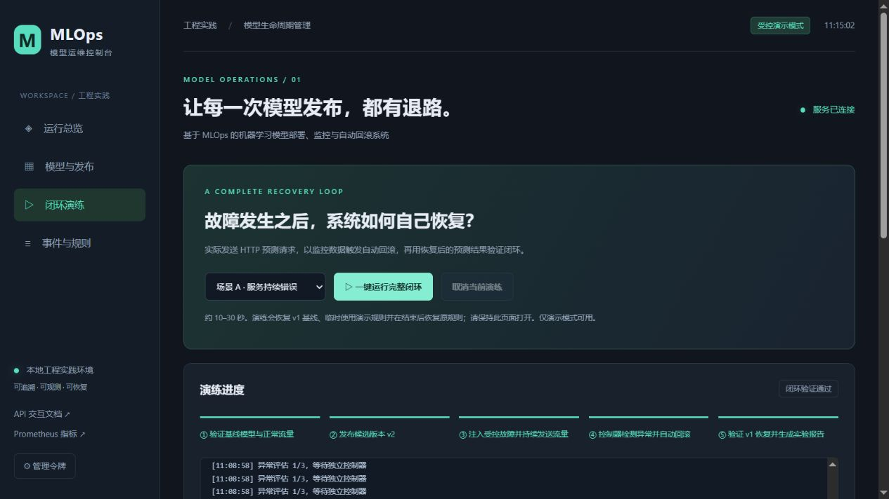
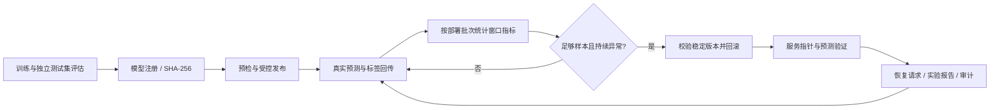

# 基于MLOps的机器学习模型部署、监控与自动回滚系统

[](https://github.com/csar1314/mlops-deployment-monitoring-rollback/actions/workflows/ci.yml)

学校工程实践项目。已实现从模型训练、版本登记、受控发布，到运行监控、异常判定、自动回滚、恢复验证和审计报告的单机完整闭环。

> 定位：可运行、可复现、可答辩的工程实践系统。采用 Iris 多分类任务验证运维机制；真实标签来自公开测试集，不代表真实生产流量或生产级模型质量保证。



## 立即运行

需要 **Python 3.11（64 位）**。不依赖 GPU，也不需要先安装 PyTorch。

**Windows：双击仓库根目录 `start.cmd`。** 首次使用时创建独立环境并安装固定依赖，随后自动打开中文控制台。

跨平台命令：

```bash
git clone https://github.com/csar1314/mlops-deployment-monitoring-rollback.git
cd mlops-deployment-monitoring-rollback
python -m venv .venv
# Windows: .venv\Scripts\activate
# Linux / macOS: source .venv/bin/activate
python -m pip install -r requirements-lock.txt
python -m src --demo --open-browser
```

- 控制台：<http://127.0.0.1:8765>
- API 文档：<http://127.0.0.1:8765/docs>
- 监控指标：<http://127.0.0.1:8765/metrics>
- 管理令牌：本地 `runtime/admin-token.txt`。一键启动通过 URL fragment 交给当前浏览器标签页，不写入 HTTP 请求 URL 或服务器访问日志。
- 首次启动自动训练并登记 v1 / v2，校验后发布 v1 为稳定基线。以后启动恢复持久化状态，不覆盖旧版本。

## 一键观察闭环

进入“闭环演练”，选择一种场景并点击“一键运行完整闭环”：

1. 验证稳定基线 v1，发送带标签的正常 HTTP 预测请求。
2. 发布正常的候选模型 v2；稳定版本指针仍保留为 v1。
3. 受控注入服务错误、额外延迟或错误预测类别，持续发送实际请求。
4. 独立定时控制器根据窗口指标、样本量、连续异常次数与持续时间判断是否回滚。
5. 校验并加载 v1，原子切换服务，检查实际服务指针与样例预测。
6. 再次发送带标签请求，确认服务恢复与预测效果，保存实验报告与事件序列。

演练临时采用演示规则，结束/取消后恢复原规则；会明确将 v1 重新设为演示稳定基线。请保持页面打开，超过 120 秒未完成的演练由控制器自动清理。



## 已实现能力

| 能力 | 实现 |
| --- | --- |
| 模型生命周期 | Logistic Regression / Random Forest 训练、固定划分、准确率/F1/混淆矩阵、不可覆盖版本、文件哈希与依赖版本校验 |
| 发布控制 | 离线准确率门槛 0.85、模型加载与输入输出预检、原子指针切换、持久化发布记录 |
| 在线监控 | 预测请求数、错误率、P95 延迟、带真实标签准确率、控制器心跳、Prometheus 指标与 Grafana 配置 |
| 回滚规则 | 按当前部署隔离窗口、最小请求/标签数、持续异常、重复快照保护、冷却期 |
| 故障处理 | 自动/人工回滚、失败保留原版本并停止自动重试、紧急人工恢复、启动时校验与稳定版本恢复 |
| 闭环证据 | 浏览器/CLI 真实 HTTP 演练、服务端报告、逐步事件、恢复后带标签预测验证 |
| 工程配套 | 管理接口鉴权、单实例 OS 锁、Windows 一键启动、Docker Compose、CI、自动化测试与中文文档 |

核心采用 **FastAPI + scikit-learn + SQLite 模型注册库 + Prometheus/Grafana**。早期候选方案中的 MLflow 已由内置注册库替代，以减少本机部署依赖；未声称集成 MLflow。

## 验证与报告

```bash
python -m pytest -q --junitxml=runtime/test-results.xml
python -m ruff check src scripts tests
# 保持服务与控制器运行，真实 HTTP 客户端不直接触发规则评估：
python scripts/demo.py --kind all
```

本地验证结果见 [测试与实验报告](docs/test-report.md)，原始记录见 [reports/validation](reports/validation)。CI 覆盖 Windows/Linux 测试，以及容器构建、完整编排、三类 HTTP 演练和监控组件健康检查；以仓库 Actions 实际结果为准。

## Docker 部署

```bash
python scripts/make_env.py
docker compose --env-file .env -f deploy/compose.yml up --build --detach --wait
```

访问控制台 8765、Prometheus 9090、Grafana 3000，均只映射本机地址。管理令牌与 Grafana 初始密码位于刚生成的 `.env`，不要提交。Grafana 用户名为 `admin`，面板自动导入。详见 [运行手册](docs/runbook.md)。

## 项目导航

- [需求与验收映射](docs/requirements.md)
- [架构与回滚状态机](docs/architecture.md)
- [部署、接口、排障与人工恢复](docs/runbook.md)
- [测试与真实实验报告](docs/test-report.md)
- [工程实践报告与答辩演示](docs/project-report.md)
- [交付清单与阶段完成情况](docs/project-plan.md)

```text
src/                 API、持久化、模型训练、回滚引擎、独立控制器、中文控制台
scripts/             真实 HTTP 演练、随机环境配置生成
tests/               核心规则、故障路径、API 与部署配置测试
deploy/              Dockerfile 与 Compose
monitoring/          Prometheus 规则、Grafana 数据源与面板
docs/                设计、手册、测试报告、答辩材料
reports/validation/  本机实测证据（不含密钥）
runtime/             本机生成的模型、SQLite、私有令牌和报告；不入库
```

## 实现边界

首版仅支持**一个 API 进程/worker + 一个共享本地状态目录**，有 OS 文件锁阻止多实例状态分叉。回滚是同一进程内的模型指针切换，不是 Kubernetes/多副本流量切换。API 整体退出、机器宕机或磁盘损坏时，需依赖进程/容器重启和外部运维处理。故障演练只影响预测路径。外网生产使用前还需 TLS、用户权限体系、外部可用性恢复、备份与多实例方案。
