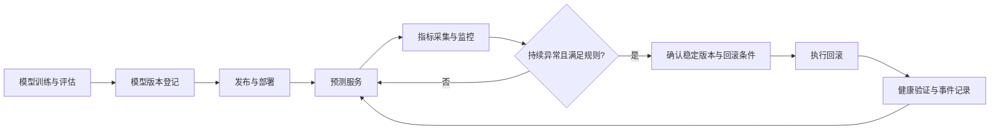

# 基于MLOps的机器学习模型部署、监控与自动回滚系统

学校工程实践项目：围绕机器学习模型从上线到运行维护的流程，设计并实现模型版本管理、服务部署、运行监控、异常告警与自动回滚的闭环。

**当前状态：项目初始化。** 本仓库已建立需求、架构和阶段计划，业务代码、部署配置与实验结果尚待实现。下文描述的是计划目标，不代表已经完成的功能。

## 项目目标

- 统一记录模型版本、训练指标、模型文件和发布记录，保证版本可追溯。
- 将模型封装为可调用的预测服务，支持健康检查与版本查询。
- 监控服务可用性、错误率、请求延迟及模型效果相关指标。
- 发现持续异常后，按照可配置规则切换到经过验证的稳定版本。
- 记录告警、发布与回滚事件，支持故障复盘与实验评估。

## 计划演示场景

以一个小型监督学习任务为示例，准备稳定模型 V1 和用于故障演示的候选模型 V2。发布 V2 后，通过受控方式注入延迟或服务错误，观察监控指标变化；系统满足触发条件后恢复 V1，并记录回滚过程。另设模型效果下降实验，仅在获得真实标签且满足最小样本量时评估效果。

## 系统流程



## 模块规划

| 模块 | 计划职责 |
| --- | --- |
| 模型管理 | 模型登记、版本查询、评估结果与文件校验信息管理 |
| 预测服务 | 模型加载、预测接口、健康检查、当前版本查询 |
| 发布控制 | 发布前校验、版本切换、发布记录与人工回滚 |
| 监控告警 | 请求量、错误率、延迟、健康状态与告警记录 |
| 自动回滚 | 规则评估、并发保护、冷却期、稳定版本恢复与验证 |
| 实验评估 | 故障注入、回滚耗时统计、误触发与恢复效果分析 |

初步技术方案：Python、FastAPI、scikit-learn、MLflow、Prometheus、Grafana、Docker Compose 和 GitHub Actions。具体版本与依赖将在首个可运行版本中固定；第一阶段采用单机部署，降低演示与复现成本。

## 仓库结构

```text
.
├── README.md                 # 项目入口与状态说明
├── docs/
│   ├── requirements.md       # 需求与验收标准
│   ├── architecture.md       # 架构与回滚机制设计
│   └── project-plan.md       # 阶段任务与交付物
├── src/                      # 后续业务代码
├── tests/                    # 后续测试与故障演练代码
├── deploy/                   # 后续部署配置
├── monitoring/               # 后续监控与告警配置
├── models/                   # 本地模型目录（模型文件默认不入库）
└── data/                     # 本地数据目录（数据文件默认不入库）
```

## 阶段计划

- [x] 建立仓库、项目说明、需求与架构文档
- [ ] 训练示例模型，建立版本记录
- [ ] 实现预测服务与容器化部署
- [ ] 接入运行指标、监控面板与告警
- [ ] 实现人工回滚与自动回滚控制器
- [ ] 完成故障演练、验证报告与演示材料

具体安排见 [项目计划](docs/project-plan.md)，验收条件见 [需求说明](docs/requirements.md)。

## 开发与复现

```bash
git clone https://github.com/csar1314/mlops-deployment-monitoring-rollback.git
cd mlops-deployment-monitoring-rollback
```

当前只有项目初始化文档与目录占位文件，尚无可启动服务。实现代码提交后，将补充依赖安装、环境变量、启动、测试和演示命令。

不要提交密码、访问令牌、个人隐私数据、虚拟环境或大体积模型文件。模型与数据采用本地目录或专用存储管理，并在后续文档中补充可复现的获取方式。
