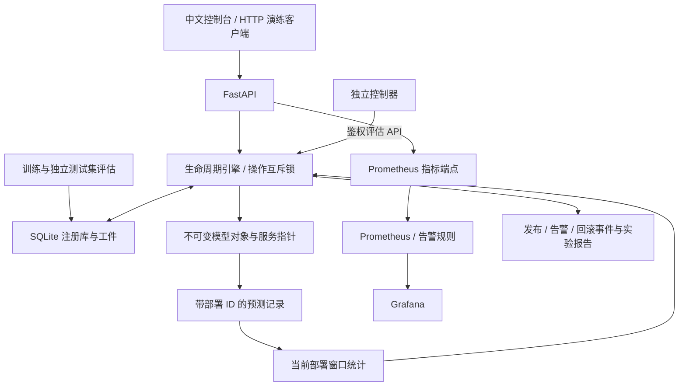
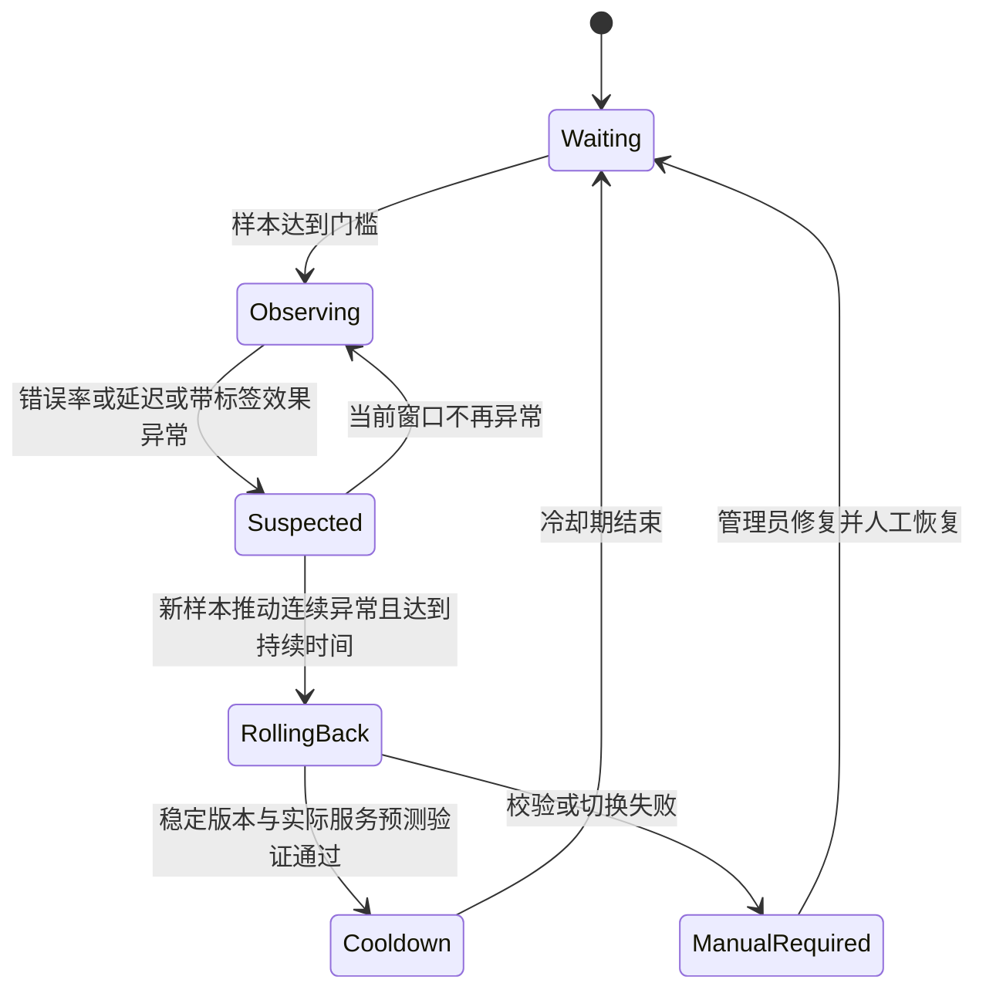

# 系统架构与回滚机制

## 组件边界

| 模块 | 代码/配置 | 责任 |
| --- | --- | --- |
| API 与控制台 | `src/app.py`、`src/web/` | 请求校验、鉴权、模型操作与中文可视化 |
| 训练与工件 | `src/training.py` | Iris 固定数据划分、训练、评估、原子工件写入与加载预检 |
| 模型与审计存储 | `src/store.py` | SQLite 注册库、状态、部署、预测、事件和实验记录 |
| 生命周期引擎 | `src/engine.py` | 模型指针、发布、晋升、监控窗口、回滚状态转换与报告 |
| 控制器 | 引擎线程 / `src/controller.py` | 周期调用规则评估；Docker 中作为独立进程访问鉴权 API |
| 可观察性 | `/metrics`、`monitoring/` | Prometheus 采集和告警、Grafana 展示 |

SQLite 替代了最初备选的 MLflow；版本登记、指标与制品校验均由本项目实际实现。Prometheus 展示与告警不直接切换模型；执行回滚的唯一入口是生命周期引擎，避免两个执行器重复触发。

## 模型与数据

- 示例数据为 scikit-learn 自带 Iris：150 条、4 个特征、3 个类别；按类别分层，随机种子 42，训练 112 条、测试 38 条。
- v1 为 StandardScaler + Logistic Regression；预处理仅在训练数据上拟合，避免测试集泄漏。
- v2 为固定参数 Random Forest，正常情况下可正确服务。错误、延迟、类别偏移由独立演练开关注入，不冒充模型自然退化。
- 工件只加载本机训练并在注册库登记的版本，无任意文件上传或外部 pickle 导入接口；SHA-256 是完整性校验，不是对不可信 pickle 的安全隔离。
- 模型版本不可覆盖，记录训练指标、混淆矩阵、数据指纹、Python 与 scikit-learn 版本。跨依赖版本工件拒绝加载，重新训练生成新版本。

## 请求与指标口径

每次完成的有效预测记录 UUID、部署 ID、模型版本、完成时间、成功标志、耗时与预测结果。真实标签通过鉴权反馈接口独立提交，相同标签重复提交幂等，不允许覆盖不同标签。

窗口默认 30 秒，仅统计**当前部署 ID**的记录。旧版本或同版本先前发布的记录不会污染新部署。P95 由窗口内实际请求耗时计算，包括服务错误的失败耗时；422 输入错误与健康探针不计入预测窗口。效果准确率只计算成功且已回传真实标签的请求，达到最小标签数后才用于回滚。

Prometheus 同时暴露进程生命周期 Counter/Histogram 和当前部署窗口 Gauge。Counter 在重启后归零；持久化审计记录仍保留。Grafana 直方图 P95 是时间区间的估计值，可能与控制器精确窗口分位数不同。请求明细保留 24 小时，控制器周期清理；部署与事件不自动删除。

## 稳定版本与发布

候选版本发布不会更改稳定指针。正常晋升需当前版本具备足够的健康预测与真实标签，并重新通过工件校验。紧急人工恢复只在人工处理/无可用模型状态开放，管理员明确指定并校验恢复版本，单独记录为 `manual_recovery`。

发布在进程级 RLock 内预加载、验证并暂时更换服务指针，确认实际指针可预测后，将新部署与状态在一个 SQLite 事务中提交。失败恢复旧指针与旧状态。预测先取得模型对象与部署快照，已经开始的旧版本请求允许完成，并归入原部署，不会被错误记到新版本。

## 回滚状态转换

规则默认：最少 12 请求、12 标签；错误率 ≥ 0.25，或 P95 > 180ms，或带标签准确率 < 0.8；至少 3 次获得新请求的异常评估且持续 2 秒；回滚后冷却 8 秒。重复评估相同请求不会增加异常计数。缺数据、低流量、控制器失联分别显示，不宣称健康。

- 稳定版本自身异常只告警，不对自身回滚。
- 锁与预期部署 ID 防止并发/过期回滚，同一部署只能成功切走一次。
- 稳定版本加载、哈希或实际指针验证失败时，保留原服务指针，停止自动重试，进入人工处理状态。
- 重启先校验持久化当前版本；失效时尝试不同的稳定版本。若无有效版本，则 readiness 返回 503，允许管理员训练新版本并紧急恢复。
- OS 文件锁禁止同一目录启动多个 API 实例。SQLite 事务不能解决多个进程的模型内存分叉，因此明确不支持多 worker。

## 演练闭环与证据

浏览器与 `scripts/demo.py` 都通过真实 HTTP 调用，不直接执行回滚或替控制器调用评估接口。独立控制器根据记录判断；报告只有在找到对应候选部署的**一次自动回滚成功事件**、v1 实际运行、至少 5 次恢复后的带标签预测、无服务错误且恢复准确率 ≥ 0.8 时才标记通过。

每个报告保存故障时刻、检测与恢复耗时、回滚执行耗时、候选统计、恢复统计、事件序列和检查项。取消或 120 秒超时会清理故障并恢复演练前规则；清理失败同样进入人工处理。演练控制接口默认关闭，只有显式 `--demo` / 环境配置启用。

## 故障边界

模型预测路径异常属于自动回滚处理范围。管理 API 自身退出、操作系统故障或磁盘不可用不由同一进程自救：Compose 提供重启策略，Prometheus 提供外部不可用告警，运维人员按手册处理。未实现分布式高可用、流量灰度、RBAC、数据漂移自动回滚或生产模型自动再训练。

参考：[FastAPI lifespan](https://fastapi.tiangolo.com/advanced/events/)、[模型持久化边界](https://scikit-learn.org/stable/model_persistence.html)、[Prometheus 直方图](https://prometheus.io/docs/practices/histograms/)。
