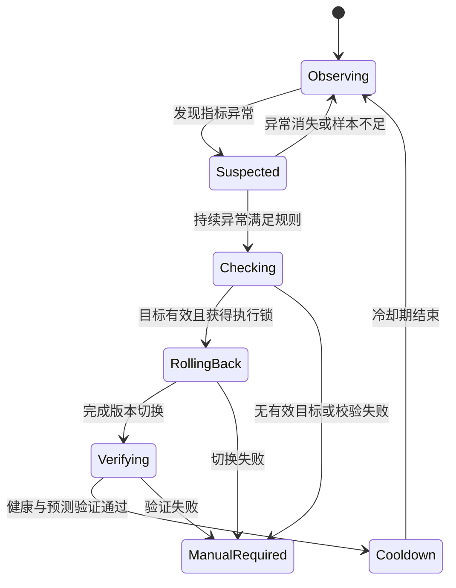

# 系统架构设计

## 初期范围

第一阶段面向单机工程实践演示，采用容器化服务与统一编排。先打通可验证的发布、监控、回滚闭环，再根据课程要求考虑灰度发布、多实例和集群部署。

## 组件与职责

| 组件 | 职责 | 初步方案 |
| --- | --- | --- |
| 训练与评估任务 | 生成模型与离线评估结果 | Python / scikit-learn |
| 模型登记与制品存储 | 记录版本、元信息、校验值与文件位置 | MLflow 与本地持久化目录 |
| 模型预测服务 | 提供预测、健康、版本与指标接口 | FastAPI |
| 监控与展示 | 采集指标、展示趋势、输出告警 | Prometheus / Grafana |
| 发布与回滚控制器 | 校验版本、切换、验证、记录事件 | 独立 Python 服务 |
| 自动化检查 | 对代码与核心行为执行检查 | GitHub Actions |
| 本地部署 | 启动与管理演示组件 | Docker Compose |

## 数据与控制边界

- 推理请求只读取已经就绪的模型实例，不直接触发训练或下载。
- 发布控制器只能选择已登记、文件完整且通过验证的模型版本。
- “上一版本”和“稳定版本”分别记录，避免将刚失败的候选版本误当成回滚目标。
- 切换前保存目标版本、来源版本与事件标识；切换后根据实际服务版本核验。
- 模型文件、事件记录和监控配置采用持久化存储，具体格式在实现时确定。

## 自动回滚状态设计

## 回滚执行规则

1. 从监控数据读取统计窗口内的指标，确认数据完整且满足最小样本量。
2. 按配置判断错误率、延迟或模型效果异常是否持续成立。
3. 检查当前版本、稳定版本、冷却期及正在执行的发布或回滚任务。
4. 获取执行锁，使用事件标识保证同一异常不重复执行。
5. 校验稳定版本文件与样例预测，保存切换记录，再执行切换。
6. 检查模型就绪状态、实际版本与预测请求；通过后记录成功并进入冷却期。
7. 操作或验证失败时记录失败原因，停止自动反复切换并提示人工处理。

## 关键设计约束

- 短暂抖动、低流量或指标缺失不能直接触发自动回滚。
- 回滚目标必须可以加载且与输入输出协议兼容。
- 服务可用性告警与模型效果告警分开处理，效果指标必须有真实标签支持。
- 演示中采用可控故障注入；生产级鉴权、高可用、复杂灰度与多租户能力不属于首版完成声明。
